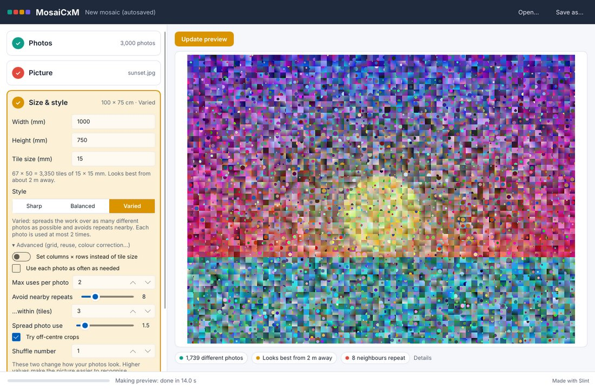
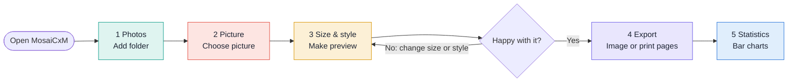
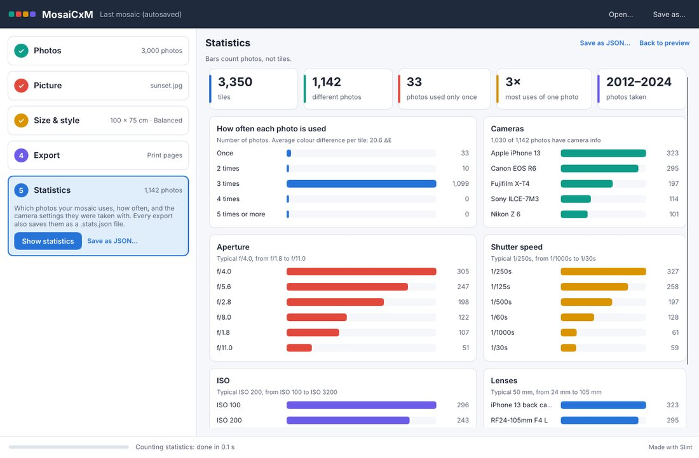

# MosaiCxM

Turn your own photos into a big photo mosaic: one picture made of thousands of small photos. MosaiCxM makes wall-sized prints (up to 3 × 3 m) that you can print at a print shop or at home on normal paper and glue together.

Mosaic creation works offline on your computer. Your original photos are never changed. Optional AI filtering can use a model on your own computer/server, or send resized previews to a cloud service you explicitly enable.

## Install

Download the latest version from the [Releases page](https://github.com/nhth-mibu/MosaiCxM/releases):

- **Windows:** download the `windows-x64.zip`, unzip it and open `mosaic-gui.exe`.
- **Mac (Apple silicon):** download the `.dmg`, drag **MosaiCxM** to Applications. The first time, right-click the app and choose **Open**.
- **Linux:** download the `linux-x64.tar.gz`, unpack it and run `mosaic-gui`. Run `./install.sh` once to add it to your app menu.

## How to make a mosaic

The app has five steps. Each step has its own colour, so you always know where you are. The preview of your mosaic stays on the right the whole time.

Need help in the app? Point at a control and wait a moment: a tooltip tells you what it does. A small **?** marks the settings that have one. Click **Help** at the top right, then **Help topics**, for short guides with screenshots for each step, printing, and common problems.

When a new version is out, the app shows a blue bar above the preview with a **Download** button. It asks GitHub once at start (nothing else is sent). To check by hand, click **Help** > **Check for updates**. To turn off the check at start, untick **Help** > **Check for updates at start**.

| Step | Colour | What you do |
|---|---|---|
| **1 Photos** | 🟢 Teal | Click **+ Add folder** and pick a folder with your photos. Add as many folders as you like. |
| **2 Picture** | 🔴 Coral | Click **Choose picture…** and pick the image the mosaic should look like. |
| **3 Size & style** | 🟡 Amber | Type the size you want, pick a style, then click **Make preview**. |
| **4 Export** | 🟣 Violet | Choose **Image file** or **Print pages (PDF)**, then click **Export**. |
| **5 Statistics** | 🔵 Blue | See which photos your mosaic uses and the camera settings they were taken with. |

### 1 Photos (teal)

Click **+ Add folder**. Before anything is added, the app shows how many photos it found and a sample of them, so you can check you picked the right folder. Click **Use this folder**, or **Pick another folder…** if it is the wrong one. The app then reads the photos in that folder, and in all folders inside it, straight away. Hidden and system folders (like the Trash or NAS thumbnail folders) are left out. You can see the progress at the bottom of the window. A few thousand photos is enough; more photos give a better mosaic.

You don't need to do anything else. Each time you open the app, it checks your folders for new or deleted photos by itself.

- **Moved a folder or unplugged a drive?** The folder is marked "not found". Click **Find it…** and show the app where the folder is now. Nothing has to be read again.
- **Some files skipped?** Click **why?** to see which files could not be read (for example, broken or unsupported files).

Use the filters in **Photos** to restrict the small photos used in your mosaic. **People / portraits** keeps photos with a clearly detected face; **No people** excludes photos with detected faces. **Photo colours** offers **All colours**, **Colour only** and **Black and white only** (using photos that are already black and white). Filters combine, so you can choose black-and-white portraits, for example. **Skip likely documents/screenshots** checks screenshot filenames and larger images from the original files, including patterns of faint handwriting on paper. Detection is approximate and can miss images or exclude a photograph by mistake; it allows ordinary photos containing incidental writing. If too few photos remain, relax the filters, allow more reuse, or add photos.

For optional model-assisted document detection, open **Photos → AI document filter (optional)**:

1. Choose **Ollama**, **LM Studio**, **vLLM**, **TypeSafe Jev**, or **OpenAI Decisions**.
2. For your own server, enter its API base URL and the name of a loaded vision model. Default URLs are `http://localhost:11434/v1` for Ollama, `http://localhost:1234/v1` for LM Studio, and `http://localhost:8000/v1` for vLLM. Replace `localhost` with your Linux/server address when needed. The model must support image input. For Ollama, install/load `gemma3:4b` or another vision model first; for LM Studio or vLLM, use the model name shown by your server.
3. Enter a server/API key if required. Keys are kept in memory for the current session and are never saved in project files or settings. OpenAI and Jev also accept `OPENAI_API_KEY` and `TYPESAFE_API_KEY` from the environment.
4. Click **Test with image…** to check one image, then **Enable model checks** to use the connection. This also enables **Skip likely documents/screenshots**. The existing preview is regenerated, or you can click **Make preview** for the first one.

Enabling or testing sends resized image previews to the selected endpoint. OpenAI and TypeSafe are cloud services and may charge for requests. TypeSafe's image support is experimental. Model connections are enabled for this session only; opening a project never enables one. Changing a connection setting disables it until you enable it again. **Use offline only** disconnects the model. Judgements are cached by photo, provider, endpoint and model, so swaps and new selections reuse them. Saved judgements survive restarts and app updates. Without a connection, the app reuses the last model’s saved judgements and checks other photos offline. Provider, endpoint and model settings are restored at startup. API keys stay in memory for the session. The first pass through a large photo collection can take a while. A failed, refused or malformed model response stops filtering with an error; it is never cached as an ordinary photo.

Provider references: [Ollama vision compatibility](https://docs.ollama.com/api/openai-compatibility), [LM Studio](https://lmstudio.ai/docs/developer/openai-compat/chat-completions), [vLLM](https://docs.vllm.ai/en/latest/serving/openai_compatible_server/), [TypeSafe image inputs](https://docs.typesafe.ai/images), [OpenAI Decisions](https://developers.openai.com/api/docs/guides/decisions).

### 2 Picture (coral)

Click **Choose picture…** and pick a JPEG, PNG, WebP or TIFF image. Faces, animals and pictures with bold shapes and clear colours work best.

Not sure which picture to use? Click **Help me choose**. The app tries pictures from a folder you pick, and some of your own photos, and ranks them by how well your photos can rebuild them.

### 3 Size & style (amber)

- **Width and height:** the size of the finished mosaic in millimetres (1000 × 750 mm is 1 m × 75 cm).
- **Tile size:** the size of each small photo. Smaller tiles make the picture easier to see; bigger tiles make each photo easier to see. The app tells you how far away to stand, for example "Looks best from about 2 m away".
- **Style:**
  - **Sharp** matches colours as closely as possible. Fastest.
  - **Balanced** also follows edges and shading, so outlines look cleaner. A good default.
  - **Varied** uses as many different photos as possible and avoids the same photo next to itself.
- **Shape:** keep the mosaic a rectangle, or give it an outline: ellipse, heart, hexagon, diamond, star, or **your own shape from a file**. In an SVG file the drawn parts are the shape; in a PNG with transparency the solid parts; in any other picture (JPG…) the dark parts. Tick **Swap inside and outside** to flip it. Tiles outside the shape stay empty (white, black or light grey), and print pages that would be empty are not printed. **Advanced → Edge tiles** sets how much of a tile must be inside the shape to get a photo.
- **Hidden message:** type a word, name or date (for example `ANNA & TOM | 2026`; `|` starts a new line). Tiles under the letters get lighter or darker photos, so the text is easy to read from across the room but hidden up close. **How easy to read** sets the strength; **Letters** picks light, dark or automatic. The size line tells you how many tiles tall the letters are. CLI: `--message "…" --message-strength 0.5 --message-tone auto`.

Click **Make preview**. This can take from a few seconds to a minute with very large photo collections. After the first preview, changes in **Size & style** update it automatically when you stop editing. Export becomes available when the update finishes. You can also click **Update preview** to retry.

To look closer, scroll or double-click the preview, and drag to move around. When you stop, the app loads the photos you see from the original files, so each one is sharp, and shows the file name of the photo under the mouse. Use **−**, **+** and the zoom percentage (click it to see the whole mosaic again) in the corner.

**Click a tile to swap its photo** for another suitable one. The other tiles and your zoom stay in place. Click **New photo selection** above the preview to choose a different mix for the whole motif. Both actions respect your photo filters and reuse limit, are autosaved, and carry through to exports. If no alternative fits the reuse limit, the app explains how to make more photos available. **Right-click a tile** to see its photo details, open the original, or find other tiles using it.

Under the preview you can see how many different photos were used and how far away the mosaic looks best. Your work is saved automatically and opens again next time you start the app. Use **Save as…** at the top to keep a copy with its own name.

Want more control? Open **Advanced** for the grid, how often each photo may be used, colour correction and more.

### 4 Export (violet)

- **Image file:** one big image file for a print shop. The app shows the size in pixels and the file size before you export.
- **Print pages (PDF):** the mosaic cut into pages for your own printer. Choose the paper (A4, A3, Letter…) and the app shows how many pages you will get. By default, it chooses the orientation with fewer print sheets.

For Canon SELPHY CP printers, choose **SELPHY Postcard (100×148 mm)**, **SELPHY L (89×119 mm)**, or **SELPHY Card (54×86 mm)**. These are the [finished photo sizes specified by Canon](https://cam.start.canon/en/P001/manual/html/UG-07_Reference_0070.html), after removing the perforated ends. To set the orientation yourself, clear **Choose orientation with fewer pages**, then use **Landscape**. L and Card sizes need the matching cassette or adapter.

Tick **Also save a list of the photos used** if you want a list of every photo in the mosaic.

**Printing at home:** print the PDF at **100% / Actual size** with **Fit to page turned off**. The first page is an A4 assembly guide; the mosaic pages use your chosen paper size. Measure the 50 mm square on the first page before you print the rest. The pages overlap a little so you can glue them together; the first page shows how they fit.

### 5 Statistics (blue)

Click **Statistics** to see facts about your mosaic as bar charts:

- how many tiles and different photos it has, and how often each photo is used
- which cameras and lenses the photos were taken with
- their aperture, shutter speed and ISO, and the years they were taken

Camera settings come from the photos' own information (EXIF). Photos without it are counted but don't appear in the camera charts.

Click **Save as JSON…** to save the numbers as a file. Every export also saves them automatically, next to the exported file, as `<name>.stats.json`.

## Good to know

- Your photos are only read. The app never changes, moves or deletes them. Photo previews are sent to a model server only when you explicitly enable or test an AI filter connection.
- If you remove a folder from the list, only the app's list changes. Your photos stay where they are.
- If there are not enough photos for the size you chose, the app tells you what to do: use bigger tiles, allow each photo to be used more often, or add more photos.
- The app follows your computer's light or dark mode.

## For developers

Building from source, the `mosaic` command-line tool, how matching works, file formats, colour handling, benchmarks and known limits are in the **[technical guide](docs/TECHNICAL.md)**.

The desktop app is made with [Slint](https://slint.dev).

Planned features (AI, then iOS and Android) are in the **[roadmap](ROADMAP.md)**.
