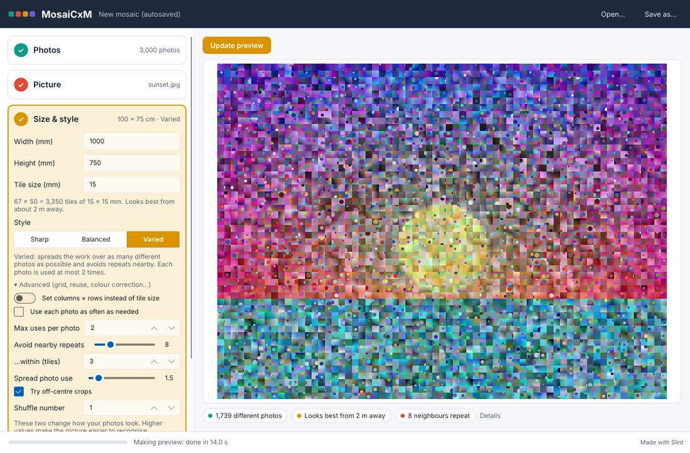
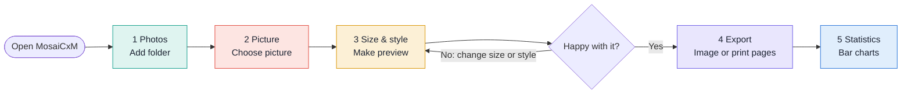
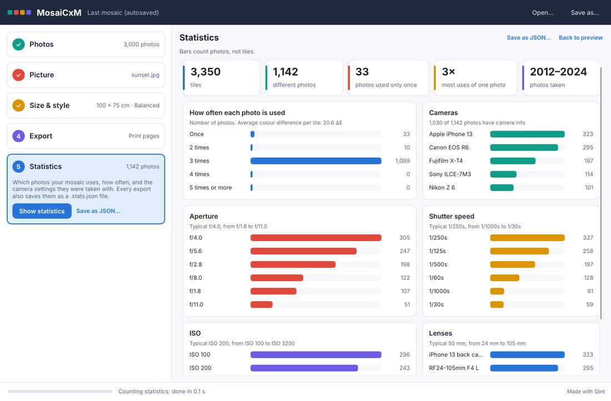

# MosaiCxM

Turn your own photos into a big photo mosaic: one picture made of thousands of small photos. MosaiCxM makes wall-sized prints (up to 3 × 3 m) that you can print at a print shop or at home on normal paper and glue together.

Everything happens on your computer. Your photos are never uploaded and never changed.

## Install

Download the latest version from the [Releases page](https://github.com/nhth-mibu/MosaiCxM/releases):

- **Windows:** download the `windows-x64.zip`, unzip it and open `mosaic-gui.exe`.
- **Mac (Apple silicon):** download the `.dmg`, drag **MosaiCxM** to Applications. The first time, right-click the app and choose **Open**.
- **Linux:** download the `linux-x64.tar.gz`, unpack it and run `mosaic-gui`. Run `./install.sh` once to add it to your app menu.

## How to make a mosaic

The app has five steps. Each step has its own colour, so you always know where you are. The preview of your mosaic stays on the right the whole time.

| Step | Colour | What you do |
|---|---|---|
| **1 Photos** | 🟢 Teal | Click **+ Add folder** and pick a folder with your photos. Add as many folders as you like. |
| **2 Picture** | 🔴 Coral | Click **Choose picture…** and pick the image the mosaic should look like. |
| **3 Size & style** | 🟡 Amber | Type the size you want, pick a style, then click **Make preview**. |
| **4 Export** | 🟣 Violet | Choose **Image file** or **Print pages (PDF)**, then click **Export**. |
| **5 Statistics** | 🔵 Blue | See which photos your mosaic uses and the camera settings they were taken with. |

### 1 Photos (teal)

Click **+ Add folder**. Before anything is added, the app shows how many photos it found and a sample of them, so you can check you picked the right folder. Click **Use this folder**, or **Pick another folder…** if it is the wrong one. The app then reads the photos in that folder, and in all folders inside it, straight away. Hidden and system folders (like the Trash or NAS thumbnail folders) are left out. You can see the progress at the bottom of the window. A few thousand photos is enough; more photos give a better mosaic.

You don't need to do anything else. Each time you open the app, it checks your folders for new or deleted photos by itself.

- **Moved a folder or unplugged a drive?** The folder is marked "not found". Click **Find it…** and show the app where the folder is now. Nothing has to be read again.
- **Some files skipped?** Click **why?** to see which files could not be read (for example, broken or unsupported files).

### 2 Picture (coral)

Click **Choose picture…** and pick a JPEG, PNG, WebP or TIFF image. Faces, animals and pictures with bold shapes and clear colours work best.

Not sure which picture to use? Click **Help me choose**. The app tries pictures from a folder you pick, and some of your own photos, and ranks them by how well your photos can rebuild them.

### 3 Size & style (amber)

- **Width and height:** the size of the finished mosaic in millimetres (1000 × 750 mm is 1 m × 75 cm).
- **Tile size:** the size of each small photo. Smaller tiles make the picture easier to see; bigger tiles make each photo easier to see. The app tells you how far away to stand, for example "Looks best from about 2 m away".
- **Style:**
  - **Sharp** matches colours as closely as possible. Fastest.
  - **Balanced** also follows edges and shading, so outlines look cleaner. A good default.
  - **Varied** uses as many different photos as possible and avoids the same photo next to itself.
- **Shape:** keep the mosaic a rectangle, or give it an outline: ellipse, heart, hexagon, diamond, star, or **your own shape from a file**. In an SVG file the drawn parts are the shape; in a PNG with transparency the solid parts; in any other picture (JPG…) the dark parts. Tick **Swap inside and outside** to flip it. Tiles outside the shape stay empty (white, black or light grey), and print pages that would be empty are not printed. **Advanced → Edge tiles** sets how much of a tile must be inside the shape to get a photo.

Click **Make preview**. This can take from a few seconds to a minute with very large photo collections. When you change something, the app shows **"Settings changed since this preview"**; click **Update preview** to see the new result.

Under the preview you can see how many different photos were used and how far away the mosaic looks best. Your work is saved automatically and opens again next time you start the app. Use **Save as…** at the top to keep a copy with its own name.

Want more control? Open **Advanced** for the grid, how often each photo may be used, colour correction and more.

### 4 Export (violet)

- **Image file:** one big image file for a print shop. The app shows the size in pixels and the file size before you export.
- **Print pages (PDF):** the mosaic cut into pages for your own printer. Choose the paper (A4, A3, Letter…) and the app shows how many pages you will get.

Tick **Also save a list of the photos used** if you want a list of every photo in the mosaic.

**Printing at home:** print the PDF at **100% / Actual size** with **Fit to page turned off**. Measure the 50 mm square on the first page before you print the rest. The pages overlap a little so you can glue them together; the first page shows how they fit.

### 5 Statistics (blue)

Click **Statistics** to see facts about your mosaic as bar charts:

- how many tiles and different photos it has, and how often each photo is used
- which cameras and lenses the photos were taken with
- their aperture, shutter speed and ISO, and the years they were taken

Camera settings come from the photos' own information (EXIF). Photos without it are counted but don't appear in the camera charts.

Click **Save as JSON…** to save the numbers as a file. Every export also saves them automatically, next to the exported file, as `<name>.stats.json`.

## Good to know

- Your photos are only read. The app never changes, moves or deletes them, and nothing is sent over the internet.
- If you remove a folder from the list, only the app's list changes. Your photos stay where they are.
- If there are not enough photos for the size you chose, the app tells you what to do: use bigger tiles, allow each photo to be used more often, or add more photos.
- The app follows your computer's light or dark mode.

## For developers

Building from source, the `mosaic` command-line tool, how matching works, file formats, colour handling, benchmarks and known limits are in the **[technical guide](docs/TECHNICAL.md)**.

The desktop app is made with [Slint](https://slint.dev).

Planned features (AI, then iOS and Android) are in the **[roadmap](ROADMAP.md)**.
